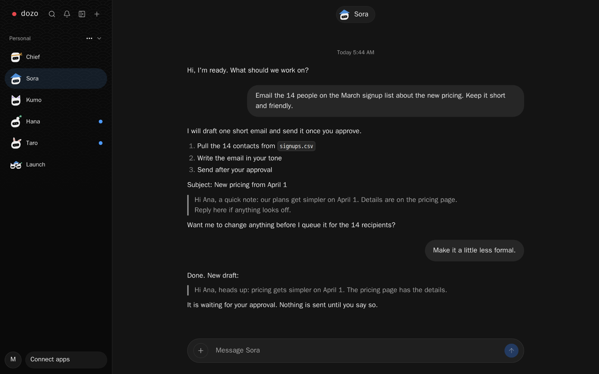
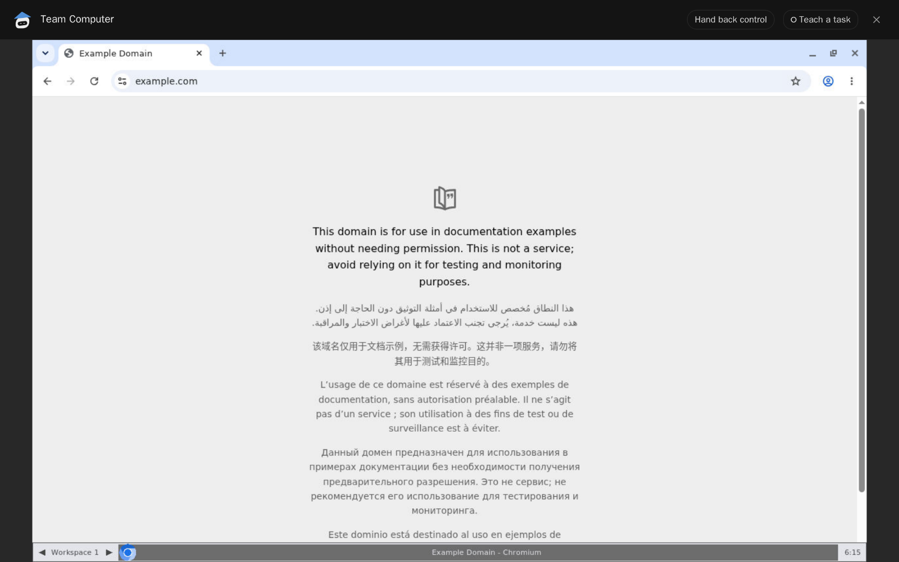
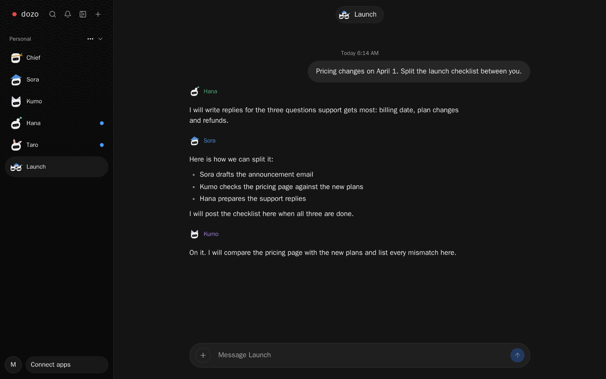
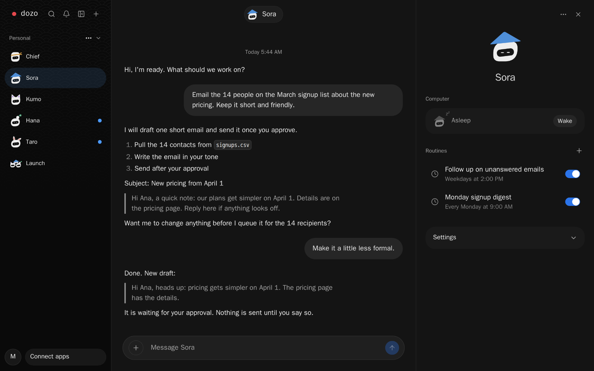
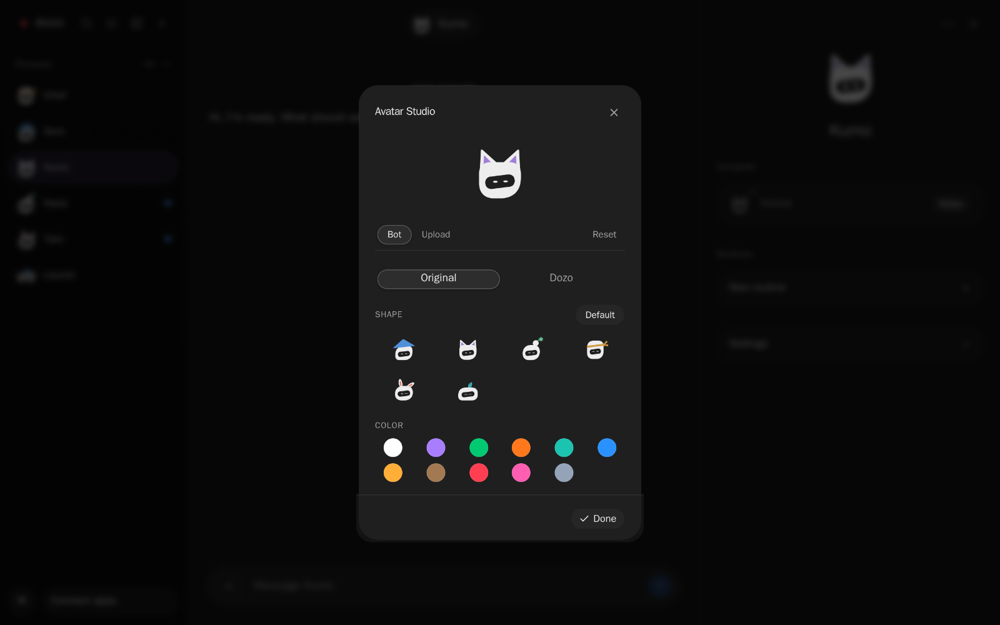

<p align="center">
  
</p>

<p align="center">Persistent AI bots, each with its own computer.</p>

<p align="center">
  <a href="https://dozo-site.ssilistre.dev">Hosted</a> ·
  <a href="https://github.com/SSilistre-dev/dozo/releases/latest">Desktop app</a> ·
  <a href="#run-it-yourself">Run it yourself</a> ·
  <a href="/LICENSE">Apache-2.0</a>
</p>



Dozo gives you bots that stay around. Each one keeps its conversation, its memory and its routines,
and works on a computer of its own. You talk to them like teammates, alone or in a group, and they
ask before they do anything that matters. This repository is the open source code.

## Features

- A computer for every bot: a browser, files and a terminal in a sandbox
- Watch a bot's screen, take control, hand it back
- Routines that run a bot on a schedule
- Memory the bots read and keep up to date between chats
- Group chats where several bots answer one request
- Approvals before consequential actions
- Any model: connect an OpenAI-compatible server or another provider with your own keys
- Skills and MCP servers to give bots more tools
- Spaces to share bots with other people
- Web app and desktop app, talking to the same server

### Every bot gets a computer

A sandboxed machine with a real browser. Open its screen, take control to sign in somewhere, and
hand it back.



### Bots that work together

Put bots in a group and give them one request. Each answers with its own part.



### Routines

Give a bot a standing instruction and a schedule. Its routines sit beside the chat, next to its
computer.



### A character for each bot

Every bot has a face you can tell apart at a glance. Pick the shape and the colour.



## Use it

**Hosted.** [dozo-site.ssilistre.dev](https://dozo-site.ssilistre.dev), in closed preview.

**Desktop app.** [Latest release](https://github.com/SSilistre-dev/dozo/releases/latest), a preview
for macOS and Windows.

### Run it yourself

You need Docker with the Compose v2 plugin (2.24.4 or newer), and `git`, `make`, `tar`, `rsync`,
`nc`, `openssl` and `curl`. The build needs network access and several GB of RAM.

```
git clone https://github.com/SSilistre-dev/dozo.git
cd dozo
make up
```

`make up` builds the images, starts the stack on `127.0.0.1` and prints the address. Create an
account there and connect a model. `make down` stops it and keeps the data. Details:
[dozo/docker/README.md](/dozo/docker/README.md). Running it on a server:
[dozo/deploy/README.md](/dozo/deploy/README.md).

## Project

- [Contributing](/.github/CONTRIBUTING.md)
- [Reporting a vulnerability](/.github/SECURITY.md)
- Apache License 2.0: [LICENSE](/LICENSE), with the fork's notice of changes in
  [dozo/NOTICE](/dozo/NOTICE)

Dozo is an independent fork of [Rakazo](https://github.com/elie222/rakazo) (Apache-2.0). It is not
affiliated with or endorsed by the Rakazo project. How the fork is organised:
[dozo/README.md](/dozo/README.md).
